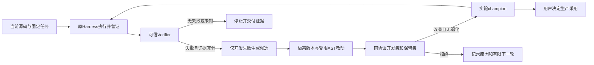

# Adrian持续进化V1

最小功能：从可信失败触发受限候选，在隔离版本中按同一验证器和任务标准比较，保留有效实验版本，并有界继续。真实业务版本仍由用户决定采用。

本批支持范围是calculator.py四则运算绑定，沿用原AST渲染器，不执行任意模型代码。知识、Prompt、Skills、Memory和任意Harness补丁尚未开放自动修改：这些范围需要先有自己的可靠验收任务。当前任务、权限、判据、保留集、更新器和资源门不向候选生成器提供写入口。



判定顺序：安全/协议/来源硬门 → 检查未知 → 原有PASS不能退化 → 保留集须PASS → 至少一个开发失败转PASS。实验晋升后下一轮从新champion开始，重复/无变化候选不重复评估；改格式或重复旧绑定不算进化。

## 持久与资源

- state.json保存冻结策略、任务、开发集ID、验证协议/控制器指纹、源码hash、结果hash、候选决策、champion及预算。
- 每次外部操作前持久预占请求槽位和费用；请求槽位按最坏数量占用、不退回，实际观测生成数单独显示。费用按已有CostLedger的峰值用量上界结算，缺证据不释放预留。
- 默认15分钟、最多3个候选/连续2次无收益；可配置范围仍有硬上限。费用/请求为同一计划累计，恢复不重置。STOPPED计划再次运行只检查证据并返回旧结果。
- 遗留active请求标为INTERRUPTED_UNKNOWN，不重放，不自动释放资源。协议或控制器改变、来源/结果文件改变即停止。文件租约避免两个运行者同时写同一计划。
- 真实API额度/账单不可直接观测；报告给保守费用估算与未知预留。当前使用DeepSeek Flash峰值输入$0.3/百万、输出$1.2/百万，依据2026-10-31[官方Models & Pricing](https://api-docs.deepseek.com/quick_start/pricing/)。只调用模型生成与必要模型元数据，不启用联网Search/Fetch工具。

## 使用

PowerShell，项目根目录，使用装有项目依赖的Python；本机是D:\python.exe：

```powershell
$env:PYTHONPATH='src;.'
# 默认离线：健康基线不会假造失败来触发更新。
D:\python.exe -X utf8 -m min_agent.evaluation.evolution_cli init --out reports/my-evolution
D:\python.exe -X utf8 -m min_agent.evaluation.evolution_cli run --state reports/my-evolution/state.json
D:\python.exe -X utf8 -m min_agent.evaluation.evolution_cli status --state reports/my-evolution/state.json
```

离线有故障副本可用`init --source 副本路径`，`run --candidates 候选数组.json`重放受限候选。此类结果标为SUPPLIED_CANDIDATE_REPLAY，只证明机制，不能声称模型自主生成。

真实批次需要明确授权及显式配置。以下是一次50请求槽位/$1计划的配置示例；同一授权不重复建新计划重置额度：

```powershell
D:\python.exe -X utf8 -m min_agent.evaluation.evolution_cli init --out reports/my-live-evolution --live --request-ceiling 50 --cost-limit 1 --seconds 900
$credentialPath=Join-Path $env:USERPROFILE 'agent-harness-credentials.json'
D:\python.exe -X utf8 -m min_agent.evaluation.evolution_cli run --state reports/my-live-evolution/state.json --live --credentials $credentialPath --proxy http://127.0.0.1:7890
```

候选生成只接收计算器相关源码、合成开发失败的结果与工具调用；不会收到保留任务/答案/得分或凭据。接受的版本保存在versions/candidate-N中，生产目录不改。

查看report.md和state.json；原Harness执行证据在runs/，提案和对比在proposals/。这些是当前可信本地控制器写入的记录，不是能抵抗同权限恶意进程的隔离沙箱。

## 回滚

回到已有实验版本：

```powershell
D:\python.exe -X utf8 -m min_agent.evaluation.evolution_cli rollback --state reports/my-evolution/state.json --version baseline
```

只改变实验版本指针和追加回滚事件，不删除历史、不重置预算、不回滚真实业务数据。未知active操作或被改动的来源拒绝自动回滚。回滚后计划停止；继续新的研究需明确新任务和资源边界。

本功能实现与本批真实结果见[阶段记录](phase-records/2026-10-31-evolution-v1.md)。设计参考[《深入理解AI Agent》第9章“构建可长期运行的持续进化闭环”](https://bojieli.github.io/ai-agent-book/book/chapter9/)。更新流程成立、产物激活、实际遵循和未见任务收益需要分别报告；五个合成计算任务不能代表整个Agent能力。
