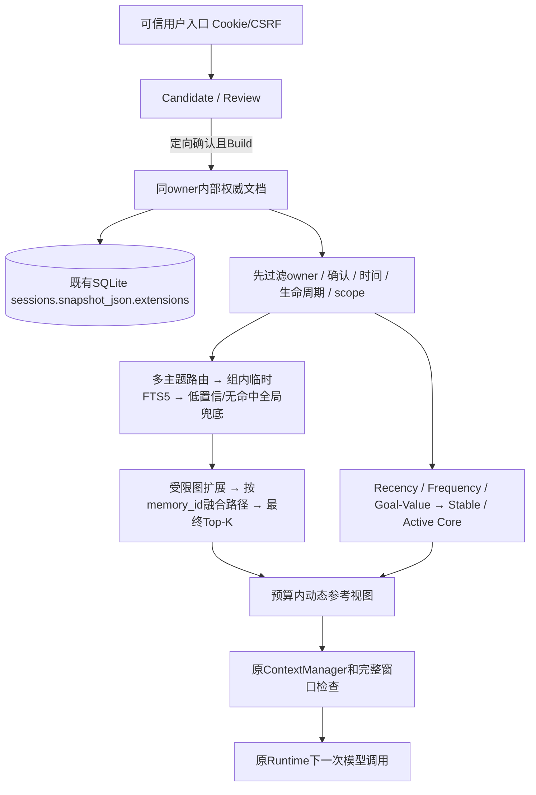
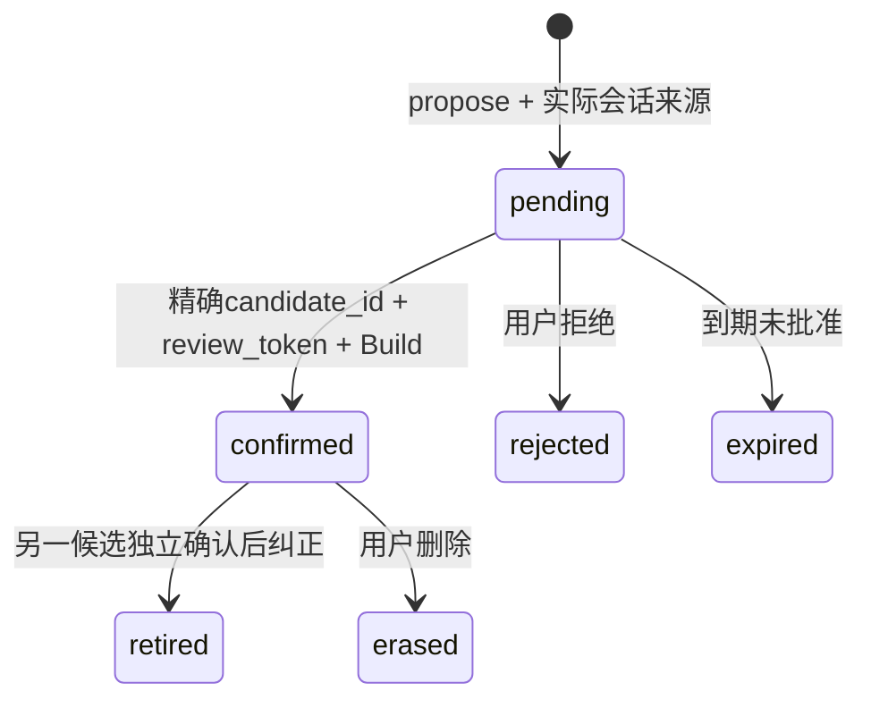

# Adrian Memory v0.1：实际实现与边界

## 目标与实现位置

在原有Runtime上加入按用户确认写入、跨会话共享但跨owner隔离的长期Memory。会话MemoryJournal、预算、工具协议、Plan/Build和检查点继续工作。未重建Agent、未引入图数据库、未调用外部模型或embedding。

源码在`src/min_agent/long_memory/`：models定义权威实体，store执行确认/事务/目标历史，retrieval负责过滤与多路检索，selection负责importance与Core视图，integration绑定现有Runtime/Web，evaluation仅供显式离线实验。旧`memory.py`仍负责当前会话归档，含义未改。

## 一份权威数据，多个可重建视图

不增加或迁移生产SQL表。`SessionStore.owner_document`在同一owner的内部专用快照里保存版本化JSON；内部session ID由owner稳定派生，不进入普通会话列表，也拒绝作为普通Runtime会话打开。写入持有既有RLock，SQLite先提交、内存后发布；失败不发布半成品。

FTS5索引在`:memory:`中只对已经授权过滤的候选重建；不可用时明确返回`lexical_fallback`。这避免生产迁移，但不是大规模索引方案。向量只预留SearchHit融合接口，未接embedding服务。程序本身仍遵循单应用写入者边界，不宣称已实现跨进程CAS。

## 实体

| 实体 | 实际保存内容 |
| --- | --- |
| Memory | 独立ID、owner、user/session范围、情景、原文/确认内容、证据类型、确认记录、观察/生效/到期时间、生命周期、版本、主题/目标关联 |
| Evidence | owner、session、消息索引、角色、观察时间、原文哈希和指针；默认不复制私人原文 |
| Candidate | 来源、候选内容及适用条件、审核凭据、到期、fingerprint、pending/confirmed/rejected |
| Topic / Scenario | owner、名称/描述/关键词或条件、创建时间；多对多关联，不按相似度覆盖独立情景 |
| Goal | 生命周期、优先级、长期/阶段、生效/观察/更新时间、来源、版本历史 |
| MemoryEdge | BELONGS_TO / APPLIES_IN / ABOUT / DERIVED_FROM / RELATED_TO / SUPERSEDES；GENERALIZES / EXCEPTION_OF类型预留，不自动建立 |
| Trace / Usage | 候选与注入ID/版本、命中路径、过滤/排序理由、预算；可信使用事件按event_id防重复，不记原文 |

相同原话拆成多个候选时共享同一个Evidence ID，不伪装成独立证据。不同来源/场景的相似记忆有独立ID；只对同一提案来源的重复请求幂等。拒绝指纹阻止重复询问，删除后的来源哈希阻止从旧来源重新提出或使用旧审核凭据。

## 用户批准和事实边界

`propose`不等于长期批准；模型没有confirm工具。确认走可信Python/API，复用现有Cookie、CSRF、owner/session和Build边界。确认时再次核验来源哈希及有效期，重复确认不产生新Memory、不重复事件、不增加revision。拒绝、忽略、过期都不能当批准。

`remember(source_index=...)`只接受实际用户消息中完整的`记住：内容`/`Remember: 内容`窄语法；从助手文字、引用中的子串或普通“是”不能猜测授权。不支持的自然语言形式需要先提候选审核，不声称已完成通用意图识别。

DIRECT要求来源角色为user；这只证明用户说过，不证明任何改写的语义必然正确，仍由精确内容审核承担。INFERRED默认标为disputed，即使获准保留也保持推断身份。一次明确广泛偏好即可审核写入，不机械要求两条证据。Core晋升不改变确认、范围、来源或事实状态。

## 时间与目标

Memory/Goal保留历史版本，`as_of`同时约束observed_at、confirmed_at、effective_from、valid_until和版本更新时间。候选观察时间不能代替后来确认时间。纠正须新候选单独批准，旧版本在过去时点仍可查询；用户隐私删除优先于历史回放，不保留已删除内容的旧版本。

Goal的priority、lifecycle、horizon分开更新。`update_goal`只改用户明确提供的字段，不会因为Adrian优先级升高就暂停求职。暂停保留Goal，明确恢复可变回active。没有目标标签时不从频率、当前题目的gold或期望答案制造正式目标。

## 检索和渐进披露

1. 先按可信owner、确认、时点、有效状态、session范围及明确场景过滤。
2. 多主题路由取Top-G；组内FTS/BM25；无组、无命中或路由分低于0.15时全局兜底。
3. 受限跳数和节点预算扩展已授权RELATED_TO邻居；不会因图边绕过过滤。
4. 各路径转换为SearchHit，在最终Top-K之前全局按memory_id合并；取最大信号，不靠命中组数累加；保留全部独立路径。
5. 当前结构化directive键覆盖历史偏好；已确认、明确适用的具体例外覆盖同键一般偏好。自由文本的复杂适用性仍交给原本的下一次模型调用，不新增分类LLM。

Root Index只含有可用已确认记忆的Topic/Scenario元数据，未知场景不提前提供正文。`read_long_memory_topic`逐步取得Topic Index的合法Memory ID；`search_long_memory`按问题检索ID。工具结果不保存事实正文，下一次动态视图从权威存储按ID取当前版本。

Memory视图附在原`RuntimeContextMessage`动态用户参考块的`untrusted_user_memory`中，不写永久System Prompt或原历史。当前请求优先，Memory不能变成权限或系统指令。原ContextManager继续检查完整请求窗口，超限停止而不放宽边界；没有额外Memory模型调用。

`assemble_context`按调用方实际可见的ID/version去重，不把“曾经注入过”当作仍可见。原Runtime的尾部视图每次重新构建，仅有一份；压缩后的下一次请求可从权威存储重建。实际模型请求的选择trace包含ID/version和预算，不包含私人正文。

## Core选择与预算

importance = 显式active Goal优先级×30 + 决策缺失代价×20 + 广度8 + DIRECT证据8 + 稳定性5 − disputed惩罚30。relevance是透明词项相关性，单独记录。Goal-Value的placement目前为importance + relevance×10；这是待实测校准的规则，不是已验证的反事实价值。

所有权重与Stable比例在`SelectionPolicy`配置模型中，可通过runner的`--policy`或HarnessApplication的`memory_policy`传入。Stable仅适用于已确认、广泛、稳定、DIRECT且active的条目，最多占Core预算35%；Active使用剩余空间。选择时计算完整序列化字段，包含ID、来源、时效，放不下就记录budget理由，不偷偷截断事实。

RECENCY只按观察时间；FREQUENCY按截至时点的独立证据/可信去重事件；GOAL_VALUE按上述价值与相关性。NONE关闭跨会话Memory视图和对应工具。HarnessApplication可配置memory_strategy、memory_budget；默认GOAL_VALUE并不意味着实验已证明它更好。

预算单位采用UTF-8字节保守上界，provider精确Token/费用另记。主实验Core预算为2048，所有策略相同；不能因某组填得少而给它更多预算。当前常驻视图会更新，不宣称KV cache收益已测量。

## 删除、恢复与限制

删除会移除权威事实历史、对应候选、孤立证据、相关边和本模块使用记录，保留不含原文的防重墓碑。已追踪的派生助手输出/工具参数会被脱敏占位替换，相关归档和压缩缓存清除；依赖旧内容的检查点失效，避免恢复过期动作。原业务对象/动作回执不撤销，原用户消息与导出文件不擅自删除，API明确返回`original_chat_erased=false`。

为清理多会话派生物，SQLite批量快照提交使用事务与SAVEPOINT，无schema变更。先持久撤回、再清理；若失败保留pending_erasure_ids，后续模型调用fail-closed，重开/重试可完成清理。运行中删除会被拒绝，先停止同用户运行中的会话，避免在飞请求继续携带旧材料。

这属于受控数据的逻辑删除，不保证磁盘取证、外部备份或已发送到外部服务的副本消失。要求连原始聊天/本地文件一并删除时，需要另行明确范围；当前入口只删除所选Memory及本模块追踪的派生物。已有外部复制品和未被本模块追踪的历史输出不宣称已清除。

## 真实验收边界

全部行为测试使用合成材料。书中60题仅运行离线时间回放/证据选择/检索，approved_fixture是100%模拟审批，raw episode不是语义记忆提取效果。8题有关键词事实标注，其余质量NOT_RUN；模型、Judge、真实任务成功率、幻觉和主动关联质量NOT_RUN。

私有106份会话仅本地适配、74/32按整段updated分割，27条规则提示只保存项目外的原文指针、未审核、正式导入0。不能把它们称为有用记忆或人工gold。完整指标与失败见reports/memory_v01/summary.md。

## 最终复核补充

删除会递归处理已追踪派生输出再次形成的候选/记忆和孤立索引实体；索引元数据也记录依赖。搜索工具仅返回短ID，不把调试trace送去自动工具摘要。原始消息时间未恢复时，observed_at为系统观察时刻，相对日期必须在审核时明确。当前版本没有自动语义候选生成器、完整UI、语义提及统计或长Memory分页工具；不能把这些描述为已完成。主实验的精确源码版本与后续删除补强分别记录，见source-version-receipt.json。
