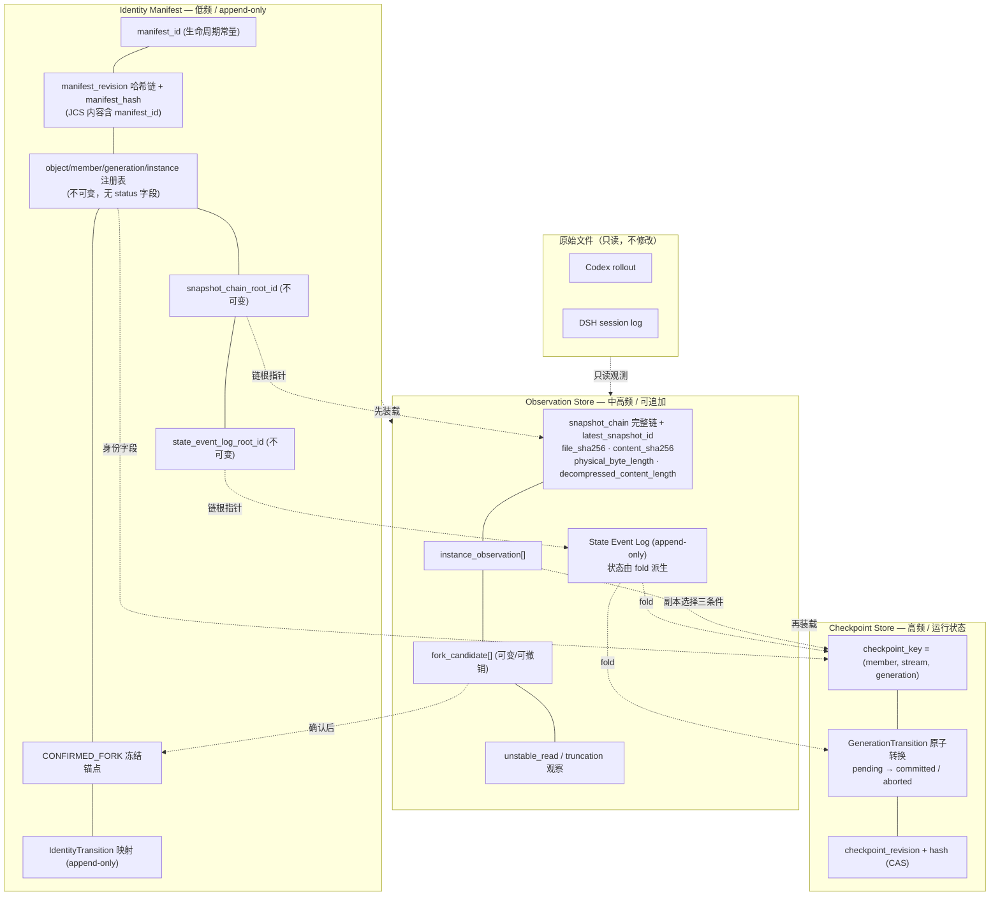
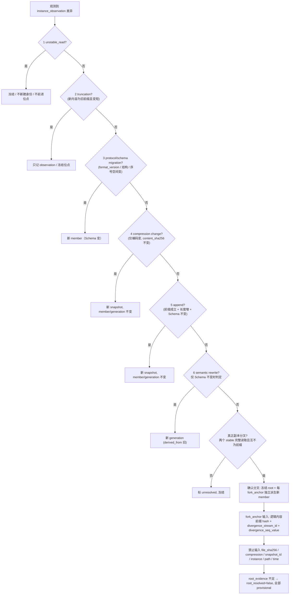
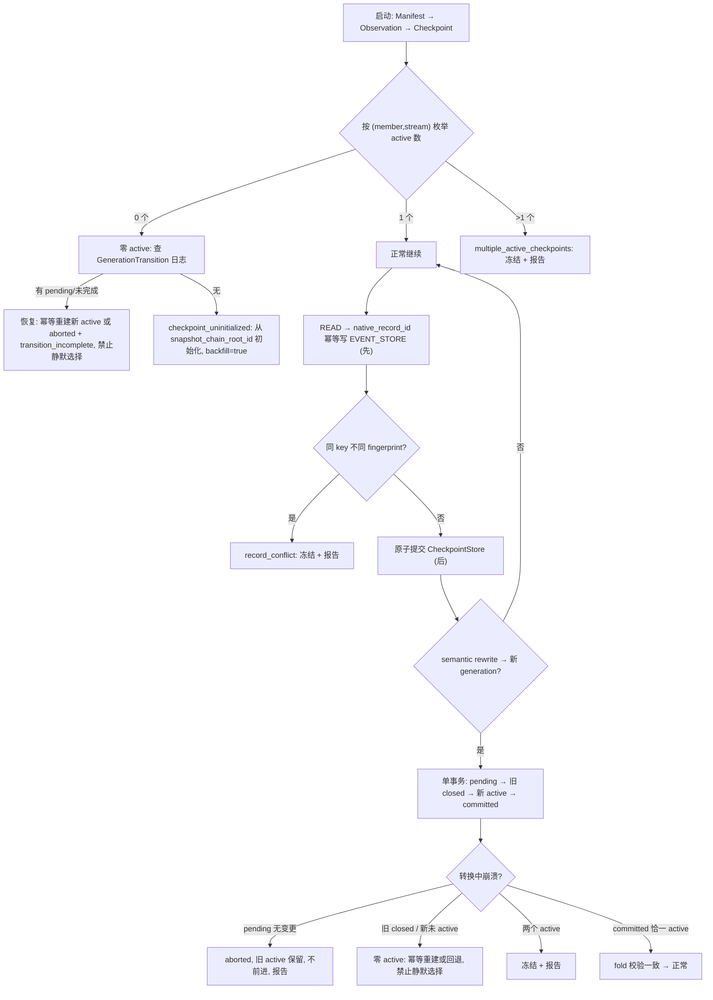

本轮为**最终定点 Errata**：未扫描或读取任何历史数据，未运行脚本，未开发 Connector，未修改 AGENTS.md、原始文件、配置或数据库，未创建 Hook/插件，未启动服务或 Phase 2，未重新打开任何已关闭历史问题。每处仅标明所修的是 v0.2.4.2 文本内部的**直接逻辑矛盾**，不扩大研究范围。

---

# Phase 0.1.2.4.2 — Final Errata 修正报告

## P0-1：Snapshot Head

`[ERROR]` **直接逻辑矛盾**：v0.2.4.2 在 Identity Manifest 中写 `SNAPSHOT_HEAD 链头锚点`，若「链头」被理解为**当前最新 snapshot**，则 append 会改变它，与「append 不改变 `manifest_revision`」冲突。

`[INFERRED]` 修正：

| 对象 | 存放位置 | 可变性 |
|---|---|---|
| `snapshot_chain_root_id` | **Identity Manifest** | **不可变**：该 generation 第一条 snapshot 的确定性 id，创建时一次写入，永久保留 |
| `first_snapshot_content_sha256` | Identity Manifest（或由 root snapshot 确定性派生） | 不可变 |
| `latest_snapshot_id` | **Observation Store** | 可更新，append / compression change 时前进 |
| `snapshot_chain` 链体（每条内容状态） | Observation Store | 只追加 |

- **append 不改变 Manifest 的任何字段、不增加 `manifest_revision`**；只追加 Observation Store 条目并更新 `latest_snapshot_id`。
- Manifest 丢失时，`snapshot_chain_root_id` 不可从当前文件哈希反推 → 走既有 `identity_recovery_mode`（provisional），禁止用当前哈希冒充。
- ER/架构图同步：`SNAPSHOT_CHAIN` 完全归 Observation Store，Manifest 只保留 `SNAPSHOT_CHAIN_ROOT`。

---

## P0-2：Append-only 状态管理

`[ERROR]` **直接逻辑矛盾**：v0.2.4.2 把 `provisional`、`confirmed`、`forked_closed`、`checkpoint status=active/closed`、`root_resolved` 等状态**写在身份注册记录上**，与「身份注册记录不可修改」冲突。

`[INFERRED]` 修正：

```
StateEvent {                         # append-only，永不修改、永不删除
   state_event_seq        // per manifest_id 单调递增
   target_id              // member / generation / instance / checkpoint / fork
   state_dimension        // identity_status | fork_status | checkpoint_status | root_status | confidence
   state_value            // provisional | definitive | confirmed | forked_closed |
                          // active | closed | root_resolved | root_unresolved | ...
   parent_event_hash      // 状态事件哈希链
   evidence_ref
   observed_at            // 审计，不进身份
}
```

- **身份注册记录只创建、永不修改**，字段全为不可变身份字段（不含任何 status）。
- 状态变化**只能**追加 `StateEvent`；**禁止就地更新 status 字段**。
- **当前状态 = 对目标的状态事件序列按 `state_event_seq` 确定性折叠（fold）**：同一 `state_dimension` 由序列中最后一个事件决定；若同一维度出现两个互斥终态且无法由序列消解 → 报告 `state_fold_conflict`，冻结，不静默取一。
- 状态事件链体存 **Observation Store**（中高频、append-only 分区）；Manifest 保存不可变的 `state_event_log_root_id` 引用，保证 Manifest 完好时可定位完整状态历史。
- 状态事件**不参与任何 ID 派生**；`manifest_revision` 只在身份注册项新增时 +1，状态事件不触发。

---

## P0-3：Root 身份稳定性

`[ERROR]` **直接逻辑矛盾**：v0.2.4.2 的 `root_member_id = derive({… root_evidence …})` 把**可变化的** `root_evidence` 放进 definitive member ID 派生 → 证据升级会导致 ID 漂移。

`[INFERRED]` 修正：

1. `root_member_id = derive(domain "adrian/uem/1/member", { source_object_id, native_branch_key, ROOT_EPOCH })` —— **不含 `root_evidence`**；一经产生**永不改变**。
2. `root_evidence` 降级为**状态/证据元数据**，通过 `StateEvent`（`state_dimension=root_evidence`）追加表达；新证据只追加事件，**不改 id**。
3. **`provisional → definitive` 必须建立显式映射**：
   ```
   IdentityTransition {
      provisional_member_id, definitive_member_id,
      evidence_ref, state_event_seq
   }
   ```
   作为**新增 append-only 记录**；历史引用 provisional id 的记录**不修改**，通过映射表解析。禁止"就地改写 id"。
4. `manifest_first_registration` **仅允许作为已有可信 Manifest 的历史证据**（`manifest_hash` 链校验通过时）；**禁止**在 Manifest 丢失/重建时用「最早发现」猜测 root。
5. 无可靠证据时保持 **`root_resolved=false`**：所有候选 member 保持 provisional，不产生 definitive root id、不合并、不删除、不判「谁保留原身份」。

---

## P0-4：Fork Anchor

`[ERROR]` **直接逻辑矛盾**：v0.2.4.2 的 `fork_anchor` 输入含 `divergence_point_snapshot_id`，而 `source_snapshot_id` 由 `file_sha256`、`compression`、`physical_byte_length` 等**物理表示信息**构成 → 同一逻辑分叉在不同压缩方式/不同物理副本下会得到**不同锚点**，违反确定性。

`[INFERRED]` 修正：

**`divergence_point_content_sha256` 语义**：两条分支**最后一个共同祖先**的解压后逻辑字节流（`decompressed_content` 空间，非物理文件字节）的 SHA-256；若以逻辑位置定义，取共同前缀的解压内容哈希。与 `file_sha256` / `compression` / `physical_byte_length` / 路径 / 实例**完全无关**。

**`divergence_point_snapshot_id` 检查结论**：包含物理表示信息 → **禁止**进入 fork_anchor 派生。

```
fork_anchor = "id1_" + hex(SHA256(JCS({
   id_schema_version: "uem-id/1",
   domain_tag:        "adrian/uem/1/member_fork",
   source_object_id, native_branch_key,
   divergence_point_content_sha256,   # 逻辑内容前缀哈希
   divergence_stream_id,              # (source_member_id, seq_namespace)，逻辑流
   divergence_seq_value               # 分叉点逻辑序号
})))
```
明确**禁止输入**：`file_sha256`、`physical_byte_length`、`compression`、`source_snapshot_id`、`physical_instance_id`、`os_file_key`、路径、时间、发现顺序。

`[INFERRED]` 一致性保证：同一逻辑分叉在 zstd / 未压缩、副本 A / 副本 B 下，`content_sha256` 相同、`seq_value` 相同 → 锚点相同。
**M5 增加固定样本 M5b**：「跨压缩方式 + 跨物理副本的 fork_anchor 一致性」正例，及「仅 `file_sha256` 变化不得改变锚点」反例。

---

## P0-5：变化分类优先级

`[ERROR]` v0.2.4.2 顺序把 `semantic rewrite` 放在 `format migration` 之前，可能把 schema 变化误判为语义重写。审核要求的新顺序及「Semantic Rewrite 仅在 Schema 不变时判定」必须落地。

`[INFERRED]` **新优先级（严格顺序，先排除再判定）**

| 序 | 类型 | 判据 | 身份动作 |
|---|---|---|---|
| 1 | **unstable_read** | 文件在写、长度抖动、zstd 流未结束、`content_sha256` 不可计算、两次观测不一致 | **不新建任何身份**、冻结、不前进 Checkpoint |
| 2 | **truncation** | 新内容是旧内容前缀且 `decompressed_content_length` 变小 | 只记 observation；**不新建 generation/member/确认分叉**；冻结位点 |
| 3 | **protocol/schema migration** | `format_version` / 记录结构键名 / 序号空间变化 | **新 member**（Schema 变） |
| 4 | **compression change** | 仅编码变化；`content_sha256`、`decompressed_content_length`、结构不变；`file_sha256`、`physical_byte_length` 变 | **新 snapshot**（member/generation 不变） |
| 5 | **append** | 前缀成立、`decompressed_content_length` 增加、**Schema 不变** | **新 snapshot**（member/generation 不变） |
| 6 | **semantic rewrite** | **仅 Schema 不变时判定**：前缀关系不成立 + 已确认稳定完整 + 平台显式重写标记或内容重排 | **新 generation**（`derived_from` 旧） |

`[INFERRED]` 关键约束：**Semantic Rewrite 只在第 3 步未命中（Schema 不变）时才可能成立**；schema 变化一律先归 migration，不得判为 rewrite。只有第 6 类新建 generation；第 3 类与 `confirmed_fork` 新建 member；第 1/2 类不新建任何身份。

Fork 流程图与分类表同步更新（见交付 3）。

---

## P0-6：Checkpoint Generation Transition

`[ERROR]` v0.2.4.2 只写「旧 closed、新 active」，未定义原子性与崩溃恢复，且未覆盖「零 active」。

`[INFERRED]` **原子转换**

```
GenerationTransition {                # append-only 状态事件 + Checkpoint Store 单事务
   transition_id,
   from: (member, stream, generation_old, checkpoint_revision_old),
   to:   (member, stream, generation_new, initial_position),
   status: pending | committed | aborted,       # 由状态事件表达
   migration_plan_ref
}
```
单事务内四步一起原子提交（CAS `checkpoint_revision` + `checkpoint_hash`），**不允许外部观察到中间态**：
1. 追加 transition `status=pending`；
2. 追加旧 checkpoint 的状态事件 `closed`；
3. 创建/追加新 checkpoint 的状态事件 `active` + 初始位点；
4. 提交 → transition `status=committed`。

**转换中崩溃的恢复规则** `[INFERRED]`

| 崩溃后发现的状态 | 恢复动作 |
|---|---|
| transition `pending`，无 closed/active 变更 | 标 `aborted`；旧 checkpoint 保持 active；新 checkpoint 不存在 → **不前进、报告 `transition_incomplete`**，按 `migration_plan` 决定（默认从头重放，不静默继承旧位点） |
| 旧 `closed` 已提交、新 `active` 未提交（**零 active**） | 从 transition 记录**幂等重建**新 active checkpoint；或回退旧 active 并标 `transition_incomplete`。**禁止静默选择** |
| 旧仍 active、新也 active（**多个 active**） | 冲突 `multiple_active_checkpoints` → 冻结写入并报告，不自动裁决 |
| 恰一个 active、transition `committed` | 正常继续；按状态事件链 fold 校验一致性，不一致 → 冻结 |
| 重复提交同一 `transition_id` | 幂等跳过，不产生第二个 active |

**三种启动状态** `[INFERRED]`

| 状态 | 处理 |
|---|---|
| **零 active** | 查 transition 日志：有未完成/committed 转换 → 按上表恢复；无 → `checkpoint_uninitialized`，从该 generation 的 `snapshot_chain_root_id` 初始化，标 `backfill=true`（默认从头） |
| **一个 active** | 正常继续 |
| **多个 active** | 冻结 + 报告 `multiple_active_checkpoints`，不自动选 |

事件持久化仍**先于**任何 Checkpoint 提交；generation 转换本身不写入业务事件。

---

## P1-1：平台级 Locator Profile `[INFERRED]`

```
LocatorProfile {
  profile_id: (platform, format_version, file_role),
  required_fields: [...],       # 缺任一 → locator_confidence=UNRELIABLE
  optional_fields: [...],       # 缺失不影响 confidence
  seq_namespace: enum,
  byte_offset_basis: "decompressed_content_length",
  normalization_rules
}
```

| profile_id | required | optional | seq_namespace | offset basis |
|---|---|---|---|---|
| `codex/rollout(jsonl\|zst)` | `seq_value(ordinal)`、`line_index`、`byte_offset_in_decompressed_stream` | `metadata`、`timestamp` | `codex.ordinal` | decompressed |
| `dsh/v4` | `seq_value(seq)`、`line_index`、`byte_offset_in_decompressed_stream` | `surfaceOp`、`sourceEventSeqs`、`time` | `dsh.seq` | decompressed |
| `dsh/old` | `seq_value(seq 或 seq0)`、`line_index` | `byte_offset`、`time0`、`time` | `dsh.seq` **与** `dsh.seq0`（两条 stream、两条 checkpoint） | decompressed |

required 缺失 → 走既有降级（`provisional_record_id`、`dedup_confidence=LOW`），不生成 definitive `native_record_id`；optional 缺失不影响 `locator_confidence`。

## P1-2：fingerprint 多候选禁止自动映射 `[ERROR] → 修正`

v0.2.4.2 允许「恢复可靠 locator 后用 `record_fingerprint` 辅助对齐并自动建立 provisional→definitive 映射」——若一个 fingerprint 对应多个候选，自动映射会错。

`[INFERRED]` 修正：
- `record_fingerprint` 匹配 **>1** 个候选 `record_locator_key` → 标 `identity_mapping_ambiguous`，**禁止自动建立映射**；保持 provisional 记录，输出**候选集合**（不排序、不取第一个、不按时间取胜、不静默选）。
- 只有**唯一候选**时才允许自动对齐，且仍追加 `IdentityTransition` 记录（append-only）。
- 需显式证据（平台原生 id、显式 lineage、Phase 0B 确认）才能消解多候选。
- 与「不同 locator 同 fingerprint 保留两条 definitive 记录」一致：不因 fingerprint 相同而合并或删除。

## P1-3：`manifest_id` ↔ `manifest_hash` 绑定 `[INFERRED]`

- `manifest_id = derive(domain "adrian/uem/1/manifest", {collector_namespace, source_object_id, manifest_epoch})`，**生命周期常量，永不改变**。
- 每个 `ManifestRevision` 的 JCS 内容**包含 `manifest_id` 字段**（作为不可变输入），因此 `manifest_hash` 隐式绑定到该 id：
  ```
  manifest_hash = sha256(JCS({ manifest_id, revision_no, parent_revision_no,
                               parent_manifest_hash, change_set_ref,
                               registries..., committed_at, writer_id }))   # 排除 manifest_hash 本身
  ```
- 读取时**三项同时校验**：① 内容中 `manifest_id` == 指针所属 `manifest_id`；② `manifest_hash` 自校验通过；③ `parent_manifest_hash` 与父 revision 一致。缺一即拒绝。
- 副本对账：不同 `manifest_id` 的副本**永不合并**；同 `manifest_id` 但哈希链分叉 → 冲突冻结。
- **明确**：`manifest_hash` 变化不影响 `manifest_id`；`manifest_id` 不随任何 revision 内容变化而变。

## P1-4：三阶段权限边界 `[INFERRED]`

| 阶段 | 允许 | 禁止 | 授权 |
|---|---|---|---|
| **A. Read-only Dry Run** | 只读扫描、哈希、结构分析、在内存/独立临时区生成候选身份与位点 | 不修改原始文件/配置/数据库；不创建 Hook/插件；不启动服务；不上云；不写正式位置的 Manifest / Checkpoint Store / Event Store | 无需额外授权（**已完成**） |
| **B. Event Store Persistence** | 在**独立测试环境副本**上写 Event Store / Checkpoint Store / Identity Manifest；执行 M1–M6 机制测试 | 不修改原始数据；不接入真实用户库；不启用生产入口；不用外部模型处理私人内容 | **需用户明确授权**：独立测试环境、写路径范围、数据边界 |
| **C. Memory / Activity Integration** | 事件接入 Memory / Activity 实体、创建真实活动或记忆 | — | **另行授权**：范围、数据隔离、费用上限、用户保留的合入/发布决策；**本设计冻结不包含此阶段实施** |

`[INFERRED]` Phase 0B 只做 A 的复核与 B 的最小机制验证；**C 不属于 Phase 0B**。只读检查完成 ≠ 允许正式持久化；外部模型调用仍须单独有界授权。

---

# Unified Event Model v0.2.4.2-final（Errata 后工作基线）

> Δ = 相对 v0.2.4.2 的 Errata。状态：**设计冻结基线，未实现、未验证**。

| 组件 | 冻结定义 | Δ |
|---|---|---|
| **Identity Manifest** | append-only **身份注册**；`manifest_id`(常量)/`manifest_revision`(仅注册项新增 +1)/`manifest_hash`(绑定 manifest_id)；保存不可变 `snapshot_chain_root_id`、`state_event_log_root_id`、`confirmed_fork` 冻结锚点、`IdentityTransition` 映射 | Δ 移除 latest_snapshot、移除可变 head、状态外移 |
| **State Event Log** | Observation Store 内 append-only 分区；`StateEvent` + 哈希链；当前状态由 fold 派生 | **新增** |
| **Snapshot / Observation Store** | `snapshot_chain` 完整链、`latest_snapshot_id`、`instance_observation[]`、`fork_candidate[]`、unstable/truncation 观察、State Event Log | Δ 承 latest 与状态链 |
| **Checkpoint Store** | `checkpoint_key=(member,stream,generation)`；`GenerationTransition` 原子转换；状态由 State Event 表达 | Δ 原子转换 + 三启动态 |
| `source_object_id` | `(platform, object_namespace, logical_id: opaque string [NFC only], object_role)` | 不变 |
| `root_member_id` | `derive({source_object_id, native_branch_key, ROOT_EPOCH})`，**不含 root_evidence** | Δ |
| `root_evidence` | State Event 元数据；不足时 `root_resolved=false` | Δ |
| `IdentityTransition` | provisional→definitive 显式映射，append-only | **新增/强化** |
| `fork_anchor` | JCS 统一式；输入仅逻辑内容/流/序号；**排除任何物理表示信息** | Δ |
| `LocatorProfile` | 平台级 required/optional 字段规范 | **新增** |
| `record_locator_key` = `native_record_id` | 不含 fingerprint；来源记录幂等键 | 不变 |
| `record_fingerprint` | 独立完整性字段；多候选禁止自动映射 | Δ |
| 变化分类 | 六类新优先级；semantic rewrite 仅 Schema 不变时判定 | Δ |
| 确定性 ID | 全层统一 `id1_ + hex(SHA256(JCS({id_schema_version, domain_tag, …})))`，全 64 hex | 不变 |
| 三阶段权限 | A 只读 / B 独立副本写路径 / C 另行授权 | **新增** |

---

# 更新后的三张图

## 1. 三层存储架构图



## 2. Fork 流程图（新排除优先级）



## 3. Checkpoint / Generation Transition 流程图



---

# 身份稳定性矩阵（Errata 更新）

`✓` 不变｜`+1` 序号递增｜`✗` 新值/新对象｜`冻结` 不前进｜`?` 需 Phase 0B

| 场景 | manifest_id | manifest_revision | manifest_hash | snapshot_chain_root_id | latest_snapshot_id | state_event_log | member | generation | checkpoint |
|---|---|---|---|---|---|---|---|---|---|
| **append** | ✓ | **✓** | **✓** | **✓** | ✗（Observation） | ✓（不追加） | ✓ | ✓ | 位点前进 |
| compression change | ✓ | ✓ | ✓ | ✓ | ✗ | ✓ | ✓ | ✓ | ✓ |
| 重命名 | ✓ | ✓ | ✓ | ✓ | ✓ | ✓ | ✓ | ✓ | ✓ |
| **身份注册项新增** | ✓ | **+1** | ✗ | ✗（新 generation 才有） | ✓ | ✓ | ✗ | ✗ 视类型 | 可能新 key |
| **状态变化**（provisional→definitive / forked_closed / active→closed） | ✓ | **✓** | **✓** | ✓ | ✓ | **✗ 追加事件**（fold 派生当前态） | ✓ id 不变 | ✓ | 状态由 fold 变 |
| protocol/schema migration | ✓ | +1 | ✗ | ✗（新 generation 视情况） | ✗ | ✗ | ✗ 新 member | ✓ | 新 member 新 key |
| semantic rewrite | ✓ | +1 | ✗ | ✗ | ✗ | ✗ | ✓ | ✗ | 旧 closed + 新 generation 新 key（原子转换） |
| unstable_read / truncation | ✓ | ✓ | ✓ | ✓ | ✓/✗ | ✗（观察） | ✓ 不新建 | ✓ 不新建 | **冻结** |
| 副本分叉确认 | ✓ | +1 | ✗ | ✓ | ✗ | ✗ | 原冻结 + ✗ 新（每锚点独立） | ? | 新 member 独立 |
| 新增第三分支 | ✓ | +1 | ✗ | ✓ | ✗ | ✗ | 前两不变 + ✗ 第三个 | ? | 仅新增 |
| 跨压缩/跨副本的同一逻辑分叉 | ✓ | +1 | ✗ | ✓ | ✗ | ✗ | **fork_anchor 相同 → member 相同** | ? | ✓ |
| 同 locator / 不同 fingerprint | ✓ | ✓ | ✓ | ✓ | ✓ | ✓ | ✓ | ✓ | **冻结 + record_conflict** |
| 不同 locator / 同 fingerprint | ✓ | ✓ | ✓ | ✓ | ✓ | ✓ | 两条保留 | ✓ | 正常前进 |
| fingerprint 多候选映射 | ✓ | ✓ | ✓ | ✓ | ✓ | ✓ | ✓ | ✓ | **identity_mapping_ambiguous，禁止自动映射** |
| 数据库重建（Manifest 完好） | ✓ | 已提交链 | 重算一致 | ✓ | 重算一致 | fold 一致 | ✓ | ✓ | ✓ |
| Manifest 丢失 | ✗ 新建 provisional | 1（新链） | 新 | provisional | 可重建 | provisional | root 未定 / provisional | provisional | provisional |

---

# M1–M6 最终实验清单及验收条件

分类：**HARD-BLOCK** = 不通过不得正式持久化｜**CONDITIONAL** = 可带 `KNOWN_LIMIT` 运行，须在 Phase 0B 验证。全部**离线、独立测试环境副本**可完成。

| # | 实验 | 分类 | 验收条件（Errata 更新） |
|---|---|---|---|
| **M1** | 三层分离 + 重建一致性 | **HARD-BLOCK** | ① `manifest_id` 在 append / checkpoint 前进 / 状态变化后不变；② append 不增加 `manifest_revision`、不改 `manifest_hash`；③ `snapshot_chain_root_id` 永久不变，`latest_snapshot_id` 只在 Observation Store 变；④ 状态事件 append-only + fold 正确，`state_fold_conflict` 被报告；⑤ revision 哈希链含 `manifest_id`，三项校验缺一即拒绝；⑥ 重建后全部确定性 ID 一致 |
| **M2** | 事件提交顺序、崩溃恢复、**Generation Transition 原子转换** | **HARD-BLOCK** | ① 事件先于 Checkpoint，重复读取不丢事件/不重复入库；② 转换四步单事务，中间态不可外见；③ 崩溃四类（pending 无变更 / 零 active / 多 active / committed 恰一 active）均按规则恢复且不静默选择；④ 重复 `transition_id` 幂等；⑤ 零 active / 一 active / 多 active 三启动态正确 |
| **M3** | `record_locator_key` 幂等 + 冲突 + **多候选禁映射** | **HARD-BLOCK** | ① 同 key 同 fingerprint 幂等；② 同 key 不同 fingerprint 必报 `record_conflict` 并冻结；③ 不同 key 同 fingerprint 保留两条；④ `record_fingerprint` 匹配 >1 候选时 `identity_mapping_ambiguous`、不自动映射；⑤ 缺 required locator 字段走 `provisional_record_id` 且不用 fingerprint 删记录 |
| **M4** | 六类变化分类固定样本（新优先级） | **CONDITIONAL** | ① 顺序严格 unstable→truncation→migration→compression→append→rewrite；② semantic rewrite **仅 Schema 不变**时判定，schema 变化不得判 rewrite；③ unstable/truncation 不新建身份、不前进位点；④ compression change 不误判为 migration；⑤ `physical_byte_length` 与 `decompressed_content_length` 分别正确 |
| **M5a** | 分叉确定性：两/三分支、任意发现顺序、锚点冻结后追加不变、root 未定 provisional | **CONDITIONAL** | 任意顺序得到相同 member 集合；第三分支不改前两个 id；`root_evidence` 不足时 `root_resolved=false` 且不猜测；provisional→definitive 有显式 `IdentityTransition` 映射 |
| **M5b** | **跨压缩方式 / 跨物理副本 fork_anchor 一致性**（本轮新增） | **CONDITIONAL** | 同一逻辑分叉在 zstd / 未压缩、副本 A / B 下锚点相同；仅 `file_sha256` 变化不得改变锚点；`divergence_point_snapshot_id` 等物理表示信息不得进入派生 |
| **M6a** | 共享 Checkpoint 副本选择三条件 | **CONDITIONAL** | 包含位点 ∧ 已确认前缀一致 ∧ 稳定完整读取；无一满足 → 冻结、不猜测、不丢事件 |
| **M6b** | NTFS 文件 ID 删除 / 重建 / 复用测试 | **CONDITIONAL** | 删除重建靠 `creation_epoch` 判为新 instance；ID 复用不导致身份混淆；Manifest 完好 / 丢失两种路径均不静默合并 |

**准入结论** `[INFERRED]`：
- **正式事件持久化准入（阶段 B）** = M1 + M2 + M3 通过 **且** 用户在独立测试环境副本上授权写路径。M4/M5/M6 为 CONDITIONAL，可带 `KNOWN_LIMIT` 运行最小只读 Connector。
- **阶段 A（只读 Dry Run）已完成**，不构成准入阻断；只读完成 ≠ 允许正式持久化。
- **阶段 C（Memory / Activity Integration）不属于 Phase 0B**，需另行授权；实时 Hook/插件（B13）仍未通过，仅阻断完整 Connector。

---

# 设计冻结声明

`[INFERRED]` v0.2.4.2-final 作为**可进入 Phase 0B 的稳定设计基线**提交并**冻结设计**：本轮结束后，除非 M1–M6（或 Phase 0B 实验）暴露**新的真实失败证据**，不再进行无证据的架构扩张或口径修订。

冻结范围：三层存储分离、append-only 状态事件与 fold、root 身份稳定性与显式映射、fork_anchor 物理表示隔离、六类变化优先级、Checkpoint 原子转换与三启动态、Locator Profile、fingerprint 多候选禁映射、`manifest_id`↔`manifest_hash` 绑定、三阶段权限边界、确定性 ID 统一规范。

`[LOCAL]` 沿用且**不重开**的既有结论：B1–B13 基础 13 项 = CLOSED 5 / DESIGN-READY 4 / PHASE-0B-REQUIRED 4，派生 B8-R 单列 1 项；B6 CLOSED 范围仅限 76 条 `tool_result_revision` 身份判定，不暗示全部 `revision_of` 已解析；U1–U16 = H 2 / M 10 / L 4，均不阻断原始历史数据的只读安全采集。

---

**Phase 0.1.2.4.2 Final Errata 到此结束。** 本轮为纯设计修订：未扫描历史数据、未开发 Connector、未修改 AGENTS.md / 原始文件 / 配置 / 数据库、未创建 Hook 或插件、未启动服务或 Phase 2、未重新打开已关闭历史问题、未扩大研究范围、未输出任何私人对话正文。等待用户审核；正式事件持久化准入需 M1–M3 通过并在独立测试环境获得写路径授权。