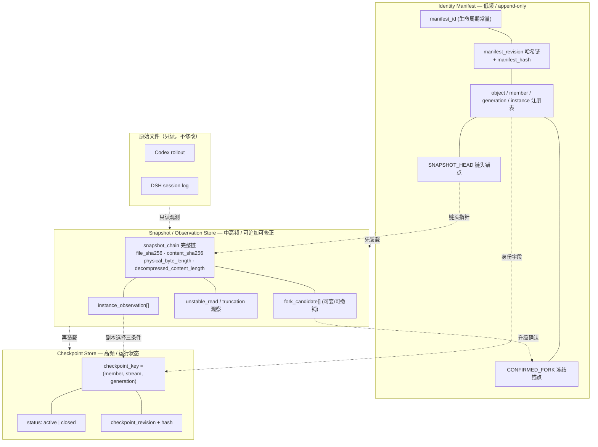

本轮为**最后一次定点设计修订**：未扫描或读取任何历史数据，未运行脚本，未开发代码，未修改 AGENTS.md、配置或数据库，未创建 Hook/插件，未启动服务或 Phase 2，未读取或输出任何私人对话正文。按约束**不重新打开已关闭历史问题**，每处仅标明所修的是 v0.2.4.1 文本内部的**直接逻辑矛盾**。

---

# Phase 0.1.2.4.2 修正报告

## P0-1：Manifest 三层分离

`[ERROR]` **直接逻辑矛盾**：v0.2.4.1 把 `snapshot_chain`（随 append/compression change 高频追加）与 `fork_candidate`（可更新、可撤销）都放进「低频、append-only」的 Identity Manifest，同时又规定 `manifest_revision` 只在身份注册项变更时 +1 —— 三者不能同时成立。

### 三层职责 `[INFERRED]`

| 层 | 职责 | 频率 | 可变性 | 自带版本 |
|---|---|---|---|---|
| **Identity Manifest** | **身份注册与低频定位**：`object/member/generation/instance` 注册表、`snapshot_chain` 的**链头锚点**、`confirmed_fork` 冻结锚点、provisional 状态 | 低 | **append-only**（条目只新增，不修改、不删除） | `manifest_id`（生命周期，永不变）/ `manifest_revision`（+1 规则见下）/ `manifest_hash`（当前版本） |
| **Snapshot / Observation Store** | `snapshot_chain` **完整链**（每次内容状态一条）、`instance_observation[]`、`fork_candidate[]`、`unstable_read` / `truncation` 观察记录 | 中｜高 | **可追加、候选可更新/撤销** | `observation_revision` / `observation_hash` |
| **Checkpoint Store** | 消费位点、状态、崩溃恢复 | 高 | 可更新（原子 CAS） | `checkpoint_revision` / `checkpoint_hash` |

- `snapshot_chain` **链头**（`first_snapshot_content_sha256`、链头 `snapshot_id`）写入 Manifest，用于恢复首次锚点；**链体**只在 Observation Store 追加。
- `fork_candidate` 只在 Observation Store；只有升级为 `confirmed_fork` 才写入 Manifest 并冻结。
- 三者通过 `manifest_id` + 身份字段关联；启动顺序：**Manifest（身份）→ Observation Store（观察）→ Checkpoint Store（位点）**。

### `manifest_revision` 的 +1 规则 `[INFERRED]`

| 变化 | `manifest_revision` |
|---|---|
| 新 `source_object` / 新 `source_member`（含分叉生成）/ 新 `source_generation` / 新 `physical_instance` 注册 / `confirmed_fork` 写入 / `instance_lineage` 变更 / provisional 状态变更 | **+1** |
| append、compression change、snapshot 新增、`instance_observation` 更新、`fork_candidate` 变化、checkpoint 前进、`unstable_read` / `truncation` 观察、observations/checkpoints 自身的 revision 变化 | **不变**（走各自 Store 的 revision） |

`[INFERRED]` 由此：**checkpoint 位点前进与 append 均不改变 `manifest_id` / `manifest_revision` / `manifest_hash`** —— 修正 v0.2.4.1 稳定性矩阵中该三列的含义混淆（矩阵已重绘，见交付 4）。ER 图中 `SNAPSHOT_CHAIN` / `FORK_CANDIDATE` 从 `IDENTITY_MANIFEST` 移出，改挂 Observation Store；Manifest 只保留 `SNAPSHOT_HEAD` 与 `CONFIRMED_FORK`。

---

## P0-2：来源记录幂等

`[ERROR]` **直接逻辑矛盾**：v0.2.4.1 定义 `native_record_id = (source_member_id, source_stream_id, record_locator, record_fingerprint)` 的确定性派生 —— `record_fingerprint` 进入派生输入后，「同 locator、不同 fingerprint」会生成**两个不同的 `native_record_id`**，看起来是两条合法记录，**绕过 locator 冲突检测**。

### 重新定义 `[INFERRED]`

```
record_locator_key = derive(domain "adrian/uem/1/record_locator", {
   source_member_id, source_stream_id, source_generation_id,
   format_version, seq_namespace, seq_value, line_index,
   byte_offset_in_decompressed_stream
})                                  # 不含 fingerprint

native_record_id    = record_locator_key      # 来源记录幂等键 = 定位符身份
record_fingerprint  = 独立字段（struct / payload / record 三层哈希）
canonical_event_id  = derive(domain "adrian/uem/1/canonical_event",
                             { native_record_id })   # 不含 fingerprint
```

### 三条硬规则 `[INFERRED]`

| 情况 | 判定 | 动作 |
|---|---|---|
| 同 `record_locator_key` + 同 fingerprint | **幂等** | 跳过，不重复入库 |
| 同 `record_locator_key` + **不同** fingerprint | **`record_conflict`** | 冻结该 locator 的采集、报告、不生成第二个 id、不前进 Checkpoint、不静默覆盖 |
| **不同** `record_locator_key` + 同 fingerprint | **保留两条独立记录** | 标 `is_same_payload=true`，不合并、不删除 |

`[INFERRED]` 因 `native_record_id` 不含 fingerprint，内容变化**无法**绕过冲突检测；`canonical_event_id` 同理稳定，不随内容改写漂移。

### 缺乏可靠 locator 的平台如何降级 `[INFERRED]`

- 引入 `locator_confidence ∈ {HIGH, LOW, UNRELIABLE}`。当平台/文件无法提供稳定的 `seq_value` + `line_index` + `byte_offset_in_decompressed_stream`（无序号的流、被重写导致偏移失效、仅能按块读取）→ 标 `UNRELIABLE`。
- 降级规则：**不生成 definitive `native_record_id`**；生成 `provisional_record_id`（含 `observation_run_id` + 顺序占位），标 `identity_provisional=true`、`dedup_confidence=LOW`。
- **provisional 下允许重复**，禁止用 `record_fingerprint` 删除记录；冲突检测退化为「同一 provisional key 的 fingerprint 变化 → 报告」。
- 恢复可靠 locator 后，用 `record_fingerprint` 作**辅助对齐**（不是去重），建立 `provisional→definitive` 映射，保留两条映射记录。
- 同步修正 Manifest 丢失降级路径：**不得退化为 fingerprint 去重**。

---

## P0-3：分叉确定性

`[ERROR]` **直接逻辑矛盾**：v0.2.4.1 的 `fork_anchor = sha256(domain("member_fork") || JCS(...))` 用了 `||` 字节拼接，与 P1 已统一的「`domain_tag` 作为 JCS 字段、不做字节拼接」冲突；且 root member 的权威身份来源、Manifest 丢失后的 root 重建均未定义。

### root member 权威身份来源 `[INFERRED]`

```
root_member_id = derive(domain "adrian/uem/1/member", {
   source_object_id, native_branch_key,
   branch_epoch: ROOT_EPOCH,        # 固定常量，非计数器、非内容哈希
   root_evidence                    # 见下
})
```
`root_evidence` 优先级（必须是**平台原生、内容无关、可持久化**的证据）：
1. 平台显式 root 标记（若存在）→ `platform_explicit`；
2. `native_branch_key` 本身（Codex 单 UUID = thread id；DSH = session id + format）→ `native_branch_key`；
3. Manifest 中最早已注册且未 `forked_closed` 的 member（**仅作回退**）→ `manifest_first_registration`。

**`[INFERRED]` 没有足够证据确定 root 时，必须允许 provisional**：`root_evidence=unresolved`、所有候选 member 标 `provisional=true`、`root_resolved=false`；**不执行「谁保留原身份」的判定**，不合并、不删除，等 Phase 0B 或平台证据再定。

### 六场景规则 `[INFERRED]`

| 场景 | 规则 |
|---|---|
| **已有 Manifest 下的分叉** | 按 `root_evidence` 确定 root → root `status=forked_closed`（**id 永不变**）→ 每个 confirmed fork 按各自冻结 `fork_anchor` 生成新 member |
| **Manifest 丢失后的重建** | 无法读 root_evidence → 全部 provisional、`root_resolved=false`；从 Observation Store 的链头 + 平台原生 key 重建候选；**不猜测 root** |
| **任意发现顺序** | 锚点由分叉点稳定快照内容派生（不含时间/路径/发现序号/当前哈希）；候选集合排序仅用于展示；每锚点独立派生 member |
| **新增第三分支** | 幂等键 = **单个 `fork_anchor`**；新增只生成第三个 member，前两个 id 由各自冻结锚点派生，完全不变 |
| **单个实例的 semantic rewrite** | **不是分叉**：同 member 内新 generation（`generation_reason=semantic_rewrite`），不产生新 member、不改 root |
| **多个实例的真实分叉** | 先过排除判据（unstable read → truncation → semantic rewrite → format migration）→ `confirmed_fork` |

### `fork_anchor` 派生规范（与 JCS 统一）`[INFERRED]`

```
fork_anchor = "id1_" + hex(SHA256(JCS({
   id_schema_version: "uem-id/1",
   domain_tag:        "adrian/uem/1/member_fork",
   source_object_id, native_branch_key,
   divergence_point_content_sha256,     // 分叉点快照，写入后冻结
   divergence_point_snapshot_id
})))
```
无 `||` 拼接、无 `0x00` 分隔、无长度前缀、无截断；全 64 hex。与 object/member/stream/generation/snapshot/instance/record/canonical_event **完全同一规范**。

---

## P0-4：变化分类

`[ERROR]` **直接逻辑矛盾**：v0.2.4.1 规定「compression change：member 与 generation 不变，只新 snapshot」，但 `compression` 是 `source_snapshot_id` 的组成字段；同时「format migration：`format_version` 或记录结构键名变化 → 新 member」。若 `compression` 变化被当作 `format_version` 变化，两条规则冲突。

### 互斥判据 `[INFERRED]`

- **compression change**：**仅物理编码变化**（none↔zstd、zstd 参数不同），且 `content_sha256` 与 `decompressed_content_length` **不变**、记录结构键名不变、`format_version` 不变 → 只新 snapshot。
- **protocol/schema migration**：**逻辑记录结构**变化 —— `format_version` 变化、记录键名/类型变化、序号空间变化（如 DSH `seq0`/`seq`）、平台语义版本变化 → 新 member。
- 二者由「`content_sha256` 是否保持 + `format_version` / 结构是否变化」互斥区分；**不允许同一变化同时归入两类**。

### 六类统一判据（严格顺序，先排除再判定）`[INFERRED]`

| 序 | 类型 | 判据 | 身份动作 |
|---|---|---|---|
| 1 | **unstable read** | 文件在写、长度抖动、zstd 流未结束、`content_sha256` 不可计算、两次观测不一致 | **不新建任何身份**、冻结、不前进 Checkpoint |
| 2 | **truncation** | 新内容是旧内容的**前缀**且 `decompressed_content_length` 变小 | 只记 observation；**不新建 generation / member / 确认分叉**；冻结位点 |
| 3 | **semantic rewrite** | 平台显式重写标记，或前缀关系不成立且已确认稳定完整 | **新 generation**（`derived_from` 旧） |
| 4 | **protocol/schema migration** | `format_version` / 记录结构 / 序号空间变化 | **新 member** |
| 5 | **compression change** | 仅编码变化，`content_sha256` 与结构不变 | **新 snapshot**（member/generation 不变） |
| 6 | **append** | 前缀成立、`decompressed_content_length` 增加、结构不变 | **新 snapshot**（member/generation 不变） |

`[INFERRED]` 只有 3 新建 generation，只有 4 与 `confirmed_fork` 新建 member；1/2 **不新建任何身份**。`append` 仍属 `snapshot_transition_reason`，不进 `generation_reason`。

---

## P0-5：Checkpoint 粒度

`[INFERRED]` 明确**实际 Key = `member × stream × generation`**：

```
checkpoint_key = (source_member_id, source_stream_id, source_generation_id)
                 # source_object_id 可由 member 推出，仅作冗余校验，不作键
```

### generation 变化后的 Checkpoint 生命周期与迁移 `[INFERRED]`

| 变化 | Checkpoint 行为 |
|---|---|
| `semantic rewrite`（新 generation） | 旧 generation 的 Checkpoint **永久冻结**（`status=closed`，保留用于历史追溯与旧 locator 对齐）；**新建**新 generation 的 Checkpoint。初始位点**不得**直接继承旧位点（旧位点属于旧逻辑字节流），由 `migration_plan` 显式给出，**默认从头重放** |
| `format migration`（新 member） | 新 member 自己的 Checkpoint，默认从头 |
| `append` / `compression change` | generation 不变 → **key 不变**，位点前进或保持 |
| `unstable read` / `truncation` | 冻结，**不新建** Checkpoint |
| 恢复 | 启动时按 `(member, stream)` 枚举**所有** generation 的 Checkpoint，只使用 `status=active` 者；出现多个 active → **冲突**，冻结并报告 |

`[INFERRED]` ER 图修正：`CHECKPOINT` 直接关联 `SOURCE_GENERATION`（不只是 `SOURCE_STREAM`）；`CHECKPOINT_STORE` 与 Manifest/Observation 三层并列。

---

## P0-6：Phase 0B 准入条件重新核对

`[ERROR]` v0.2.4.1 存在两处统计/口径错误：

1. **M1–M6 并非全部阻断**：M1/M2/M3 是硬阻断（不验证则无法保证身份稳定、不丢事件、不重复入库）；M4/M5/M6 影响**边界正确性**，但设计已提供保守降级（冻结、不猜测、provisional、KNOWN_LIMIT），最小只读 Connector 可**带边界运行**。
2. **U1–U16 等级统计错误**：v0.2.4.1 写「H=2 / M=9 / L=5」，实际逐项核对为 **H=2（U1、U7）/ M=10（U2,U3,U4,U5,U6,U9,U11,U13,U15,U16）/ L=4（U8,U10,U12,U14）= 16**。
3. **U9 与 M5/M6 对应不完整**：U9 含「分叉判定」→ M5，与「NTFS 文件 ID 删除/重建/复用防护」→ **无对应实验**。本轮按用户要求把该测试加入 **M6 的第二个子实验 M6b**（保持 M1–M6 编号不变），并明确 U9 → M5 + M6b。
4. **区分两类准入**：
   - **原始文件只读检查**（Phase 0 / 0.1 / 0.1.1 / 0.1.2 系列）：只读扫描、哈希、结构分析 → **已完成**，不构成 Phase 0B 阻断。
   - **正式事件持久化准入**（写路径：事件入库、Checkpoint 提交、Manifest 持久化）→ **需要 M1–M3 通过 + 用户在独立测试环境授权**；只读检查完成 ≠ 允许正式持久化。

---

## P1：规范化、Lineage 与 ID 一致性 `[ERROR] → 修正`

### opaque `logical_id` 规范化
`[ERROR]` v0.2.4.1 写「小写化、去花括号」—— 对非 UUID 的 opaque id（如 DSH 目录编码名、未来平台任意字符串 id）会破坏不透明性。

`[INFERRED]` 修正：
- `logical_id: opaque string`，**只做 UTF-8 NFC 规范化**；**不做小写化、不去花括号、不解析 UUID、不截断、不转义**（字符串转义由 JCS 负责）。
- 如需比较，另设 `logical_id_comparison_key = lowercase(NFC(logical_id))`，**仅用于匹配辅助，不进任何身份派生**。
- 身份派生一律用原始 opaque `logical_id` + `platform` + `object_namespace` + `domain_tag` 域分隔；不同平台规范化后相同也不混淆。

### Manifest revision lineage `[INFERRED]`
```
ManifestRevision {
   manifest_id, revision_no, parent_revision_no, parent_manifest_hash,
   manifest_hash, change_set_ref,
   committed_at /*审计*/, writer_id /*审计*/
}
```
- `revision_no` 单调递增，**只由身份注册项变更触发**（P0-1 规则）；
- `parent_manifest_hash` 构成**哈希链**，防止分支/回滚被静默接受；
- 副本对账比较 `(manifest_id, revision_no, parent_manifest_hash, manifest_hash)`；同 revision 不同 hash 或断链 → 冲突、冻结；
- 崩溃恢复取「哈希链完整 + 自校验通过 + 指针已提交」的最大 `revision_no`；
- **`manifest_id` 不属于任何 revision**，是生命周期常量。

### 所有 ID 派生规则统一 `[INFERRED]`
```
id = "id1_" + hex( SHA256( JCS({
        id_schema_version: "uem-id/1",
        domain_tag: <见表>,
        ...fields
    }) ) )        # 全 64 hex，无截断、无拼接、无长度前缀
```
| domain_tag | 派生对象 |
|---|---|
| `adrian/uem/1/object` | `source_object_id` |
| `adrian/uem/1/member` | `source_member_id`（含 root `ROOT_EPOCH`） |
| `adrian/uem/1/member_fork` | `fork_anchor` |
| `adrian/uem/1/stream` | `source_stream_id` |
| `adrian/uem/1/generation` | `source_generation_id` |
| `adrian/uem/1/snapshot` | `source_snapshot_id` |
| `adrian/uem/1/instance` | `physical_instance_id` |
| `adrian/uem/1/record_locator` | `record_locator_key` = `native_record_id` |
| `adrian/uem/1/canonical_event` | `canonical_event_id` |
| `adrian/uem/1/checkpoint` | Checkpoint 记录标识（非 key） |

`[UNKNOWN]` `semantic_event_id` 跨来源语义身份生成规则仍不定义，仅保留字段位。

---

# Unified Event Model v0.2.4.2（工作基线）

> Δ = 相对 v0.2.4.1。状态：**可进入 Phase 0B 实验的稳定设计基线；未实现、未验证**。

| 层 | v0.2.4.2 | Δ |
|---|---|---|
| **Identity Manifest** | append-only 身份注册 + `SNAPSHOT_HEAD` 链头锚点 + `CONFIRMED_FORK`；`manifest_id` / `manifest_revision` / `manifest_hash` + revision 哈希链 | Δ 三层分离、lineage |
| **Snapshot / Observation Store** | `snapshot_chain` 完整链、`instance_observation[]`、`fork_candidate[]`、unstable/truncation 观察；自带 revision/hash | **新增层** |
| **Checkpoint Store** | `checkpoint_key = (member, stream, generation)`；自带 revision/hash；`status ∈ {active, closed}` | Δ key 粒度与生命周期 |
| `source_object_id` | `(platform, object_namespace, logical_id:opaque string [NFC only], object_role)` | Δ opaque 规范化 |
| `source_member_id` | 含 `ROOT_EPOCH` 与 `root_evidence`；root 可 provisional | Δ root 权威来源 |
| `fork_anchor` | JCS 统一式，分叉点快照冻结；幂等键 = 单锚点 | Δ 派生规范 |
| `record_locator_key` | **不含 fingerprint**；= `native_record_id` | **新增/重定义** |
| `record_fingerprint` | 独立完整性字段，禁止单独去重、不进 id 派生 | Δ |
| `canonical_event_id` | 派生自 `native_record_id`，不含 fingerprint | Δ |
| `locator_confidence` | `HIGH/LOW/UNRELIABLE` + `provisional_record_id` 降级 | **新增** |
| 变化分类 | 六类严格优先序；compression change 与 migration 互斥判据 | Δ |
| 提交顺序 | 先事件持久化 → 后 Checkpoint 原子提交（at-least-once） | 不变 |
| 确定性 ID | JCS 唯一序列化、SHA-256 全 64 hex、domain_tag 字段化、全层一致 | Δ 统一 |
| 不变量 | 旧 member 身份不可变；不凭 fingerprint 删记录；同 locator 不同 fingerprint 必报冲突；unstable/truncation 不新建身份；Manifest 丢失不冒充首次锚点 | Δ 增补 |

---

# 三层存储架构图



**Checkpoint ER 修正**：`CHECKPOINT` 直接关联 `SOURCE_GENERATION`（非仅 `SOURCE_STREAM`）；`SNAPSHOT_CHAIN` 与 `FORK_CANDIDATE` 不再挂 `IDENTITY_MANIFEST`。

---

# 身份稳定性矩阵（v0.2.4.2）

`✓` 不变｜`+1` 序号递增｜`✗` 新值/新对象｜`冻结` 不前进｜`?` 需 Phase 0B

| 场景 | manifest_id | manifest_revision | manifest_hash | observation_revision | member | generation | snapshot | instance | locator(已有) | native/canonical id | checkpoint |
|---|---|---|---|---|---|---|---|---|---|---|---|
| **Checkpoint 位点前进** | ✓ | ✓ | ✓ | ✓ | ✓ | ✓ | ✓ | ✓ | ✓ | ✓ | 位点前进（key 不变） |
| 身份注册项新增 | ✓ | **+1** | ✗（当前版本） | ✓ | ✗ 新增 | ✗ 视类型 | ✓ | ✗ 视类型 | ✓ | ✓ | 可能新 key |
| append | ✓ | ✓ | ✓ | ✗（新条目） | ✓ | ✓ | ✗ | ✓ | ✓ | ✓ | 位点前进 |
| compression change | ✓ | ✓ | ✓ | ✗ | ✓ | ✓ | ✗ | ✓/✗ | ✓ | ✓ | ✓ |
| 重命名 | ✓ | ✓ | ✓ | ✗ | ✓ | ✓ | ✓ | ✓ | ✓ | ✓ | ✓ |
| protocol/schema migration | ✓ | +1 | ✗ | ✗ | ✗ 新 member | ✓ | ✗ | 可能✗ | 旧保留 | ✓（旧） | 新 member 新 key |
| semantic rewrite | ✓ | +1 | ✗ | ✗ | ✓ | ✗ | ✗ | 可能✗ | 旧 generation 保留 | ✓（旧） | 旧 closed + 新 generation 新 key |
| **unstable read** | ✓ | ✓ | ✓ | ✗（观察） | ✓ | **✓ 不新建** | ✓ 不新建 | ✓ | ✓ | ✓ | **冻结** |
| **truncation** | ✓ | ✓ | ✓ | ✗（观察） | ✓ | **✓ 不新建** | ✗ 仅记 | ✓ | ✓ | ✓ | **冻结** |
| 物理副本（未分叉） | ✓ | ✓ | ✓ | ✗ | ✓ | ✓ | ✓ | ✗ | ✓ | ✓ | **✓ 共享位点** |
| 副本分叉确认 | ✓ | +1 | ✗ | ✗ | 原冻结 + ✗ 新（每锚点独立） | ? | ✗ | ✓ | ✓ | ✓ | 新 member 独立 |
| 新增第三分支 | ✓ | +1 | ✗ | ✗ | **前两 member 不变** + ✗ 第三个 | ? | ✗ | ✓ | ✓ | ✓ | 仅新增 |
| 重压缩新文件替换 | ✓ | ✓ | ✓ | ✗ | ✓ | ✓ | ✗ | ✗ | ✓ | ✓ | ✓（key 不变） |
| 同 locator / 不同 fingerprint | ✓ | ✓ | ✓ | ✓ | ✓ | ✓ | ✓ | ✓ | ✓ | **同一 id → record_conflict** | **冻结** |
| 不同 locator / 同 fingerprint | ✓ | ✓ | ✓ | ✓ | ✓ | ✓ | ✓ | ✓ | 两条 | **两条保留** | 正常前进 |
| 数据库重建（Manifest 完好） | ✓ | 恢复到已提交链 | 重算一致 | 重算一致 | ✓ | ✓ | ✓ | ✓ | ✓ | ✓ | ✓ |
| Manifest 丢失 | ✗ 新建 provisional | 1（新链） | 新 | 可能新建 | provisional（root 未定） | provisional | ✓ | provisional | ✓ | **BROKEN** | provisional |

---

# Checkpoint / Fork 流程（更新版）

## Checkpoint 生命周期 `[INFERRED]`

```
启动: 装载 Manifest(身份) → Observation Store(观察) → Checkpoint Store(位点)
      → 按 (member, stream) 枚举所有 generation 的 checkpoint
      → 只取 status=active 者；多个 active → 冲突冻结
      → 副本选择三条件: 包含位点 ∧ 已确认前缀一致 ∧ 稳定完整读取
      → 无一满足 → checkpoint_source_unavailable，冻结

运行: READ → 完整性校验(record_fingerprint)
      → 按 native_record_id(=record_locator_key) 幂等写 EVENT_STORE  [必须先成功]
      → 同 key 不同 fingerprint → record_conflict，冻结+报告
      → 原子提交 CheckpointStore 新 revision                    [必须最后]

generation 变化(semantic rewrite):
      旧 checkpoint → status=closed（永久保留）
      新 generation → 新 checkpoint（key 中 generation 不同）
      初始位点由 migration_plan 显式给出，默认从头重放
```

崩溃点保证不变：**宁可重复读取，不丢事件**；禁止 Checkpoint 先于事件提交。

## Fork 流程 `[INFERRED]`

```
1. Observation Store 记录 fork_candidate（可变、可撤销）
2. 排除判据按顺序: unstable_read → truncation → semantic_rewrite → format_migration
3. 连续两次稳定完整观测一致 → 升级 confirmed_fork
4. fork_anchor = JCS 统一式(分叉点快照, 冻结)，写入 Manifest → manifest_revision +1
5. 确定 root: root_evidence 优先级；不足 → root_resolved=false，全部 provisional，不判「谁保留」
6. 每个 fork_anchor 独立派生新 member_id；root 仅 status=forked_closed，id 永不变
7. 新 member 各自 Checkpoint；第三分支只新增，前两 member id 不变
8. 任意发现顺序 → 相同锚点集合 → 相同 member 集合
```

---

# M1–M6 最终实验准入清单

**最小 Connector** = 只读历史补录（不依赖实时 Hook/插件、不创建真实活动或记忆实体）。
分类：**HARD-BLOCK** = 不通过则不得正式持久化｜**CONDITIONAL** = 可带 `KNOWN_LIMIT` 运行，须在 Phase 0B 验证。

| # | 实验 | 离线可完成 | 分类 | 验收标准 | 对应未解决项 |
|---|---|---|---|---|---|
| **M1** | Manifest 三层分离持久化 + 重建后全部确定性 ID 重算一致；`manifest_id` 在 checkpoint 前进/append 后不变；revision 哈希链完整 | 是 | **HARD-BLOCK** | 重建前后 member/generation/native_record_id/canonical_event_id 全一致 | U1 |
| **M2** | 事件提交顺序与崩溃恢复离线注入（各崩溃点） | 是 | **HARD-BLOCK** | 重复读取但不丢事件、不重复入库；Checkpoint 不先于事件 | U1 |
| **M3** | `record_locator_key` 幂等 + `record_conflict` 固定样本（含「不同 locator 同 fingerprint 必须保留」与「同 locator 不同 fingerprint 必报冲突」反例） | 是 | **HARD-BLOCK** | 三条硬规则全部成立；冲突被报告并冻结 | U15 |
| **M4** | 六类变化分类固定样本（含 unstable read / truncation 反例、compression change 与 migration 互斥） | 是 | **CONDITIONAL** | 1/2 类不新建身份、不前进位点；compression change 不误判为 migration | U11 |
| **M5** | 分叉确定性：两分支/三分支、任意发现顺序、锚点冻结后追加不变、root_evidence 不足时 provisional | 是 | **CONDITIONAL** | 任意顺序得到相同 member 集合；第三分支不改前两个 id；root 未定不猜测 | U9（分叉部分） |
| **M6a** | 共享 Checkpoint 的副本选择三条件（含「无一满足 → 冻结」反例） | 是 | **CONDITIONAL** | 不猜测、不前进、不丢事件 | U9（副本部分） |
| **M6b** | **NTFS 文件 ID 删除、重建及复用测试**（本轮新增，保持 M1–M6 编号） | 是 | **CONDITIONAL** | 删除重建后靠 `creation_epoch` 判为新 instance；ID 复用不导致身份混淆；Manifest 完好/丢失两种路径 | U9（ID 复用）、U13 |

**准入结论 `[INFERRED]`**：
- **正式事件持久化准入** = M1 + M2 + M3 通过 **且** 用户在**独立测试环境副本**上授权写路径（不修改原始文件）。
- **原始文件只读检查已完成**，不构成准入阻断；只读完成 ≠ 允许正式持久化。
- M4/M5/M6 为 CONDITIONAL：可带 `KNOWN_LIMIT` 运行最小只读 Connector，但必须登记并在此后验证。
- B13 实时 Hook/插件实验（E1–E4）**不属于最小 Connector 准入**，仍未通过。

---

# U1–U16 正确统计及剩余风险

## 等级统计（逐项核对，共 16 项）

| 等级 | 项 | 数量 |
|---|---|---|
| **H** | U1、U7 | **2** |
| **M** | U2、U3、U4、U5、U6、U9、U11、U13、U15、U16 | **10** |
| **L** | U8、U10、U12、U14 | **4** |
| 合计 | | **16** ✓ |

`[ERROR]` 修正 v0.2.4.1 的「H=2 / M=9 / L=5」（总数虽为 16，但 M/L 分布错误）。

## 是否阻断最小 Connector

| 类别 | 项 | 说明 |
|---|---|---|
| **HARD-BLOCK（须先验证）** | U1（H）、U15（M） | 对应 M1/M2/M3；均**离线可完成** |
| **CONDITIONAL（可带 KNOWN_LIMIT 运行）** | U9（M，→ M5 + M6a + M6b）、U11（M）、U13（M）、U16（M） | 已定义保守降级（冻结/不猜测/provisional） |
| **不阻断最小 Connector** | U2、U3、U4、U5、U6（完整语义）、U8、U10、U12、U14 | 影响修订链/监控/展示精度 |
| **阻断完整 Connector 而非最小 Connector** | U7（H，B13 实时采集，仍未通过） | 实时通道未验证 |

## 剩余风险 `[INFERRED]`

1. **身份长期稳定性**：M1 未做之前，Manifest 重建与 revision 哈希链在真实部署中的行为仍是设计假设（H）。
2. **写路径安全性**：M2/M3 未做之前，「不丢事件、不重复入库、冲突必报」是设计约束而非已验证事实（H/M）。
3. **边界正确性**：M4/M5/M6b 未做之前，变化分类、分叉确定性、NTFS ID 复用防护依赖保守降级运行，需登记 `KNOWN_LIMIT`（M）。
4. **完整语义理解**：`revision_of` 全量解析、跨修订链映射、29 条 generation 关系、运行时 STALLED/flush 仍未解决；**不阻断最小只读 Connector**（M）。
5. **B13 实时采集完全未验证**，不得声称通过（H，仅阻断完整 Connector）。
6. **`semantic_event_id`** 跨来源语义身份规则仍 `[UNKNOWN]`，本基线只保留字段位（L）。

`[LOCAL]` 全部 16 项均**不阻断原始历史数据的只读安全采集**；阻断的是正式持久化写路径与完整语义/实时能力。

---

**Phase 0.1.2.4.2 到此结束。** 本轮为最后一次定点设计修订：未扫描历史数据、未修改原始文件、未编写代码、未修改 AGENTS.md、未创建 Hook 或插件、未启动服务或 Phase 2、未重新打开已关闭历史问题、未扩大研究范围。v0.2.4.2 作为可进入 Phase 0B 实验的稳定设计基线提交。等待用户审核；正式事件持久化准入需 M1–M3 通过并在独立测试环境获得写路径授权。