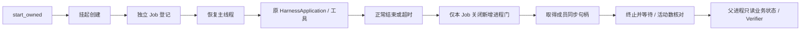

# Adrian V1：进程清理修复与离线交付

日期：2026-10-27，Asia/Shanghai。结论：本轮修复与适用离线验收完成。完整 pytest 为 **1259 passed / 3 deselected / 1 warning**；最终夹具的定向复验为 **17 passed**。本轮新增真实 Provider / Codex CLI 生成调用 **0**。

复用已有 Evaluation Harness 与 HarnessApplication。没有创建新 Agent Loop；没有修改 Runtime 权限、模型输出预算、生产 Memory 或数据库 schema；未部署、提交、推送或合并。新源码、测试、候选工作树与失败证据全部保留。

## 1. 本轮范围与版本

用户授权修复刚发现的问题，并按完整 V1 任务书继续完成离线交付。默认真实模型额度为 0，未沿用旧报告中曾经批准的生成额度。

| 对象 | SHA-256 |
| --- | --- |
| 本轮开始生产源码 | f135af28a876b9c1d6660c1b87a2d1ed1dd3ebbcb00c3436176b112fda6cb4d7 |
| 本轮交付生产源码 | c953ec972ec5d6825d009509e5bbf203b8e3b8dcba3456f26e5be2fcf24a60f7 |
| 受控修复三题契约 | 618fb6fd42b57564a35470388e6e8919e53e4bb417b50e9bccd0c72e86354aa8 |
| 新 wheel | cce6b24c118724c3f82bedf4197781ae0577303f5fb25a53570f15d346a18b7e |

源码 hash 使用原 worker.source_version 算法，包含实际本地修改；不以 Git HEAD 代替工作树。`source/src/` 与当前生产源码一致。

实际增量共 9 份工程文件：

- 修改 evaluation/processes.py 与 runner.py，新增 evaluation/_windows_job.py。
- 修改进程测试与 Memory 工程测试，新增 integration/test_evaluation_cleanup.py。
- 更新 docs/EVALUATION_V1.md，两份 lock 仅规范化行尾。

逐项记录见 [source-changes.json](source-changes.json)、内容增量见 [fix.patch](fix.patch)，行尾变化另见 [lock-format.json](lock-format.json)。Runtime、Session、Research、生产 Memory、Provider、权限与冻结 TaskSpec 实现均未改动。215 项旧报告证据文件逐项校验未变化，见 [final-integrity.json](final-integrity.json)。

## 2. 修复的真实进程问题

旧 stop_owned 只在根 PID 仍活动时执行 taskkill。根进程自然退出、后代重定向标准输出时，communicate 可以正常结束，但后代仍持锁。原报告目录保留的最小复现已证明该问题；本轮先把它变成回归，得到 2 failed，见 process-red.txt。

当前调用链：



核心代码位于 [processes.py](../../src/min_agent/evaluation/processes.py)、[_windows_job.py](../../src/min_agent/evaluation/_windows_job.py) 和 [runner.py](../../src/min_agent/evaluation/runner.py)。Windows 使用标准库 ctypes，不增加第三方依赖。

```python
# start_owned：命令开始执行前先建立所有权。
process = subprocess.Popen(command, creationflags=CREATE_NO_WINDOW | CREATE_SUSPENDED, ...)
job.assign(process.pid)
job.resume(process.pid)

# WindowsJob.stop：停止阶段才关闭新增门，再获得稳定等待集合。
try:
    self._prevent_new_processes()
    handles = self._process_handles(deadline)
    TerminateJobObject(self.handle, 1)
    # 等待已取得成员的同步句柄，并核对 ActiveProcesses == 0。
except BaseException:
    self.close()  # KILL_ON_JOB_CLOSE 发起清理，仍向上报告未知。
    raise
```

该摘录说明顺序，不是可独立运行的替代实现；参数校验、句柄关闭和超时均在源文件中。

采用 Job 而不继续扩大 taskkill/PID 树扫描，是因为后者依赖父 PID 仍存在，并存在后代遗漏、PID 复用和启动竞态。挂起创建解决“登记之前已生成后代”；独立 Job 保证同级任务互不终止。登记失败时命令不执行。

实现过程中没有把第一次 GREEN 当作完整证明：

1. 只核对 Job 活动计数时，原持锁测试仍失败，见 process-green-01.txt / process-green-02.txt；加入成员句柄等待后通过。
2. 独立审查确认，句柄清单查询失败时尚未发起终止；新增公开接口回归 RED，修复为整体异常保护并显式关闭 Job，保留 UNKNOWN。见 query-failure-red.txt / query-failure-green.txt。
3. 独立审查在 8 轮受控探测中，有 2 轮观察到快照后新增的后代未被等待。新增确定性屏障回归再次 RED，见 late-child-red.txt。最终仅在停止阶段设置 ACTIVE_PROCESS=1，先阻止新增成员，再取句柄。1 个无门对照与 2 个门控探测确认：原 9 个成员仍存活持锁，新建进程被拒绝，随后均已清理。见 review-active-limit-probe/result.json。

这不是降低任务执行预算：停止门在取消或清理时才启用，原模型、工具次数和权限门仍由 Runtime 管理。

runner 正常结束也执行清理；启动失败或清理无法确认时保存 UNKNOWN 的 result.json，记录 stage 与 error_type，不导出原始异常中的环境/认证信息。WindowsJob 查询失败也发起清理，但不能因此把“已发起终止”写成“确认全部退出”。

原最小复现重跑见 [exited-parent-probe/result.json](exited-parent-probe/result.json)：`descendant_still_holds_lock=false`、`cleanup_lock_reacquired=true`。其中 child_finished_and_released=false 表示后代被强制结束，没有机会写协作退出的 done 标记；不能将该字段解读为仍持锁。另有独立安装 wheel 的真实探测明确核对 job_drained=true，见 wheel-smoke.json。

官方依据及章节：

- [Job Objects — Managing Processes in Jobs / Terminating Jobs](https://learn.microsoft.com/en-us/windows/win32/procthread/job-objects)。
- [Process Creation Flags — CREATE_SUSPENDED](https://learn.microsoft.com/en-us/windows/win32/procthread/process-creation-flags)。
- [JOBOBJECT_BASIC_LIMIT_INFORMATION — ActiveProcessLimit / Remarks](https://learn.microsoft.com/en-us/windows/win32/api/winnt/ns-winnt-jobobject_basic_limit_information)。
- [TerminateProcess — Remarks](https://learn.microsoft.com/en-us/windows/win32/api/processthreadsapi/nf-processthreadsapi-terminateprocess)。终止是异步过程，需等待进程句柄。

## 3. 长原文失败的正确归因

原有失败是实际 partial、测试预期 completed。本轮调查证明：显式来源没有被截断，两个工具均成功；第二次模型请求在上下文门处被拒绝。

原 32K Mock 窗口扣除输出预留 4096 与安全余量 1024 后，允许 request_bound 上限为 27648。工具返回后实际 30663；即使删除全部旧历史，当前完整轮仍为 28008。见 [memory/DIAGNOSIS.md](memory/DIAGNOSIS.md) 及 current-only-diagnosis.json。最初“只需压缩旧历史”的假说因此被否证，没有实施该生产修改。

工程测试现在显式使用合成模型能力接口，分别验证：

- 64K 合成容量：completed，模型实际看到了完整原文，原有来源、结构化回忆与否定句断言保留。
- 原 32K 配置：partial/context_limit，只调用一次模型，不虚报完成；完整工具响应和可补读来源仍在持久记录中。

两种场景均核对每次已派发请求遵守相同输出预留和安全余量。64K 明确是测试夹具，不是真实 Provider 窗口，也没有提高生产默认窗口。生产 context.py、压缩实现、原文读取工具及模型能力发现均逐字未改。

这项变更修正了过时的工程测试容量假设，**不是证明同一 32K 输入现在能完成，也不是 Memory 能力提升**。旧失败记录保留，冻结 Evaluation TaskSpec、Gold 与 20 题判据未改。

## 4. 实际验证结果

环境：Windows 11 10.0.26200，Python 3.13.16，项目 .venv。完整环境见 final-integrity.json。

| 检查 | 结果 | 原始证据 |
| --- | --- | --- |
| 首次新增进程回归 | 2 failed，确实检出原缺陷 | process-red.txt |
| Runner 新增边界 RED | 3 failed | runner-red.txt |
| 独立审查 | 首次 FAIL，修复后 PASS | independent-review.md / independent-review-final.md |
| 原针对性复验 | 25 passed | targeted-green.txt |
| 最终进程/执行器/Memory/调度器恢复 | **17 passed，89.73 秒** | final-targeted.txt |
| Memory 与上下文补充 | 24 passed | memory-green-confirmed.txt |
| 完整 pytest | **1259 passed / 3 deselected / 1 warning，586.23 秒** | full-tests.txt |
| 相同冻结 20 题 | **15 PASS / 2 FAIL / 3 UNKNOWN**，全部符合预期 | offline-suite/summary.json |
| 修复前后同契约比较 | 20 题全部可比较，判定无变化 | baseline-comparison.json |
| 已保存真实候选离线重放 | 加法 FAIL→PASS，减法/乘法仍 PASS，61 passed | candidate-replay/improvement.json / calculator-regression.txt |
| 语法检查 | 退出 0 | compile.txt |
| 依赖一致性 | No broken requirements found | dependencies.txt |
| 离线 wheel 构建与独立安装 | 通过；89 份包文件与源码逐字匹配 | build.txt / wheel-install.txt / source-changes.json |
| 安装包真实进程/锁/输入输出 | 通过，job_drained=true | wheel-smoke.json |
| 全工作树差异空白检查 | 退出 0 | diff-check.txt |
| 类型 / Python linter | SKIP：未配置，未另装工具 | final-integrity.json |

并行验证中，一次原有超时测试在 5 秒内未完成后代持锁准备，故 13 passed / 1 failed，见 process-and-runner-green.txt。随后将测试夹具改为先等待持锁标记，再触发 communicate 超时，避免把机器启动速度当判据；生产超时策略没有改变。完整回归执行期间生产源码保持冻结；最终夹具另以 17 项定向复验核对。该运行和首次失败均未覆盖。

完整回归保留一条 Starlette/httpx 弃用警告，没有为消除警告更换依赖。部分命令并发执行，本轮也新增了实际进程边界测试；不把本次耗时与旧报告作性能对比。

两份 lock 的依赖条目逐行完全一致，仅 CRLF→LF；Git 原先标记的行尾问题已消除。限定范围的日志检查未发现与当前敏感环境变量值匹配的正文，见 log-redaction.json；wheel 未包含数据库、.env 或日志。以上是检查范围内的结果，不是全面漏洞或依赖 CVE 审计。

## 5. V1 复用、验收与闭环边界

完整架构、数据契约、调用图、替代方案与 Windows 操作见 [EVALUATION_V1.md](../../docs/EVALUATION_V1.md)。当前链路仍为冻结 TaskSpec → runner → 独立 owner/Session/SQLite → HarnessApplication → 原 Runtime/Registry/Research/Memory → 真实业务观察 → 独立 Verifier → 报告/比较。

| V1 要求 | 当前证据与边界 |
| --- | --- |
| 统一入口调用真实应用 | 冻结任务实际运行 HarnessApplication，父进程只读重新打开测试业务库 |
| 五类统一契约 | Research、Memory、Tools、Runtime、Security 共用 TaskSpec/Observation/EvaluationResult |
| 成功、失败、无证据区分 | 固定 20 题包含 PASS、故意 FAIL 与 UNKNOWN；语义支持不靠引用存在性冒充通过 |
| 虚假成功与权限硬门 | tools.false_success 被判 FAIL；Plan 拒绝写入、跨 owner/Session 与危险参数回归仍通过 |
| 隔离、恢复与未知副作用 | 新库/独立 Session、持久预算、原调度器崩溃恢复、超时 UNKNOWN；新增 Job 清理边界已覆盖 |
| 同标准版本比较 | 20 题前后契约一致；三题修复契约 digest 与旧版一致 |
| 受控改进闭环 | 隔离注入 Add→subtract，失败被检出；重放保存候选，AST 白名单应用，三题及 61 项回归通过；未合并 |
| 既有回归 | 本轮完整 1259 通过；工程 fixture 的容量/准备时序修正有独立说明，不用计数变化宣称能力提升 |

本轮候选 `generator=SUPPLIED_CANDIDATE_REPLAY`、`model_invocations=0`；79 份非目标源码受保护，`auto_merged=false`。这是已保存真实候选的复验，没有伪装成新模型生成。先前真实 Codex 生成、三项 DeepSeek 的原始结果仍见 [旧报告](../eval-v1/REPORT.md)；其中研究任务失败仍保留。本轮未重新核验价格、余额、账单或模型自然语言质量。

## 6. Windows 复现

在项目根目录 PowerShell 使用 .venv，输出目录必须选择尚不存在的新名称：

```powershell
$env:PYTHONPATH='src'
.\.venv\Scripts\python.exe -X utf8 -m pytest -q
.\.venv\Scripts\python.exe -X utf8 -m pytest -q tests/unit/test_evaluation_processes.py tests/integration/test_evaluation_cleanup.py tests/integration/test_memory_tools.py
.\.venv\Scripts\python.exe -X utf8 scripts/run_adrian_frozen_eval.py --source reports/fix-20261027-v1/source --protocol reports/eval-v1/acceptance-protocol.json --out reports/replay-job-fix-NEW
.\.venv\Scripts\python.exe -X utf8 -m min_agent.evaluation improve --out reports/repair-job-fix-NEW --candidate reports/eval-v1/codex-improvement/candidate.json
.\.venv\Scripts\python.exe -X utf8 -m compileall -q src tests
.\.venv\Scripts\python.exe -X utf8 -m pip check
git diff --check
```

新增任务使用原 `evaluation export` 导出、按 docs/examples/evaluation-task.schema.json 创建 TaskSpec 数组，再 `evaluation run --file <文件> --out <新目录>`。比较使用原 `evaluation compare`，不同契约会被拒绝。需要真人语义审查时使用原 review 命令保存独立注释，不改原分数或安全硬失败。

## 7. 仍未被本轮证明的事项

- 非 Windows 分支未实机执行；当前通过结论限于本机 Windows 及实际离线样本。
- Job 是可信任务的生命周期管理，不是恶意代码 OS 沙箱；结束本地进程不能撤销远端已发生的动作。
- 本轮未新测真实模型、浏览器交互、主观满意度、通用自主编程或真实 10 小时无人值守。原独立浏览器/真实生成历史只保留其原边界。
- 任意语义支持、外部副作用结果未知时仍为 UNKNOWN；不以机械测试通过代替模型任务质量。

本轮适用工程检查：READY。完整能力范围与历史失败按上述边界保留。
